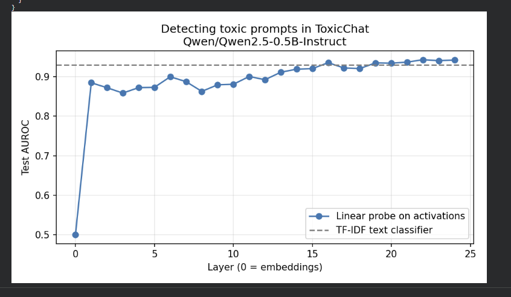

# Can a model's own activations flag harmful prompts better than a text classifier?

A small interpretability and safety experiment. I take real user prompts that people sent to a chatbot, run them through an open-weights instruction-tuned model, and train a **linear probe** on the model's hidden states at every layer to predict whether the prompt is toxic. I compare that against a **TF-IDF text classifier** that never looks inside a model.

**Status:** first full run complete (Nov 2026). Results below.

## Why this matters

Content filters that only read the text can be dodged by rephrasing, role-play and jailbreak templates. If a model *internally represents* "this request is harmful" even when the wording is disguised, a cheap linear probe on its activations could be a stronger, harder-to-evade safety signal. This project tests that on a small model, and pays particular attention to **jailbreak attempts**, the cases where text-only filters tend to fail.

## Setup

| | |
|---|---|
| Data | [ToxicChat](https://huggingface.co/datasets/lmsys/toxic-chat) (`toxicchat0124`): real user prompts to the Vicuna demo, human-labelled for toxicity and jailbreaking |
| Model | `Qwen/Qwen2.5-0.5B-Instruct` (any Hugging Face causal LM works via `--model`) |
| Features | Hidden state at the last token after the chat template opens the assistant turn, i.e. the moment the model decides how to respond. Mean pooling available via `--pooling mean` |
| Probe | Standardise + logistic regression (class-balanced), one per layer |
| Baseline | TF-IDF (word 1–2 grams) + logistic regression on the same split |
| Metrics | AUROC, average precision (the class is ~7% positive), F1, and recall on jailbreak prompts |
| Control | Probe retrained on shuffled labels (5 runs). Should land near AUROC 0.5. If not, the probe is learning something other than toxicity |

## Run it

Fastest: open `notebooks/run_on_colab.ipynb` in Google Colab, choose a T4 GPU runtime, and run all cells (about 10 minutes).

Locally:

```bash
pip install -r requirements.txt
python scripts/run_experiment.py --model Qwen/Qwen2.5-0.5B-Instruct
pytest -q   # tests run without a GPU or model download
```

Outputs go to `results/`: `metrics.json` and `auroc_by_layer.png`. Activations are cached in `cache/`, so re-running the probes with different settings doesn't need the model again.

## Results

First run: 2,000 training and 1,000 test prompts from ToxicChat (7.1% toxic in test), `Qwen2.5-0.5B-Instruct`, last-token activations.



| | TF-IDF text classifier | Best linear probe (layer 22) |
|---|---|---|
| AUROC | 0.931 | **0.943** |
| Average precision | **0.723** | 0.694 |
| F1 at 0.5 | 0.595 | **0.680** |

**Shuffled-label control:** AUROC 0.476 (mean of 5 runs), i.e. chance. The probe is reading a real signal.

**What the layers show.** Layer 0 scores exactly 0.5. That is expected: the last token is the same chat-template token for every prompt, so the embedding carries no information about the prompt. From layer 1 the probe jumps to about 0.88, then improves fairly steadily with depth, passing the text classifier around layer 16 and peaking in the last few layers (22-24). Information about whether a prompt is toxic becomes more linearly readable deeper in the model.

**Honest read.** The probe beats the text classifier on AUROC and F1 but is slightly behind on average precision. With one split and 71 toxic test prompts, the AUROC gap (0.012) is small and could be within noise. Treat this as "comparable, with a hint of an edge", not a decisive win.

**Error analysis.** Looking at prompts where the two methods disagree, the probe gives very high scores to prompts about sensitive topics (drugs, hacking, weapons, sexual content, role-play set-ups), including many that ToxicChat's annotators labelled non-toxic. The text classifier, by contrast, scores most of these in the middle. So the probe seems to track "risky topic or intent" more than the dataset's narrower "toxic" label. Some of its false positives are arguably label disagreements rather than mistakes.

**Next steps**

- Repeat over several random splits and report confidence intervals
- Test on a cleaner harmful-request dataset where topic and intent are labelled separately
- Compare model sizes, and mean vs. last-token pooling
- Check whether the probe transfers to prompts in other languages

## Limitations

- One small model (0.5B parameters). Larger models may represent harmfulness differently.
- ToxicChat labels "toxic" broadly, so this is not a pure "dangerous request" label.
- A linear probe shows that information is *readable* from activations, not that the model *uses* it.
- Jailbreak positives in the test set are few, so jailbreak recall has wide uncertainty.

## Repo layout

```
src/misuse_probe/   data loading, activation extraction (+ cache), probes, baseline
scripts/            run_experiment.py: end-to-end run
tests/              unit tests on synthetic data
notebooks/          Colab runner
```

Uses public research data only.
